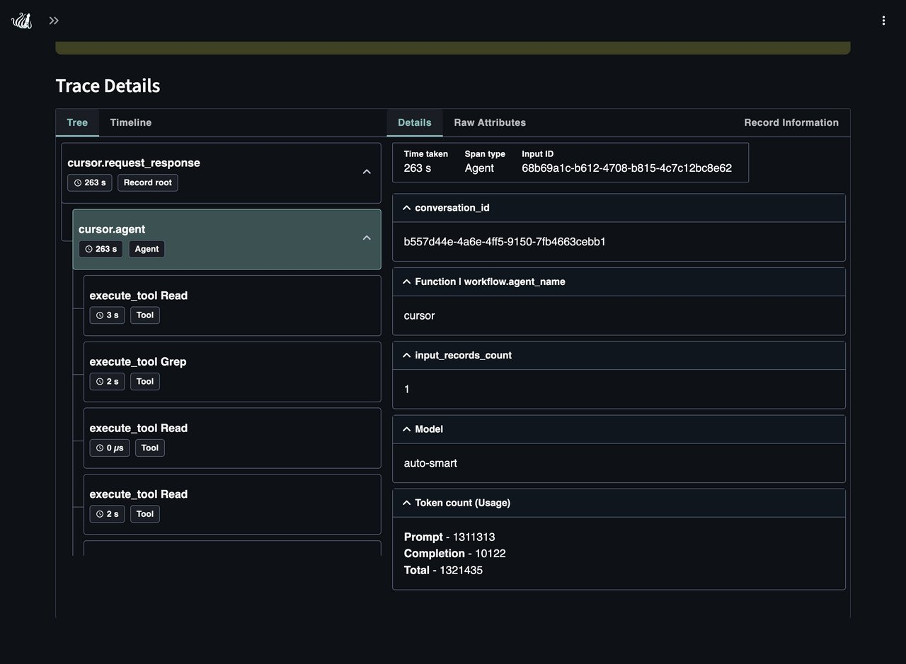

---
categories:
  - General
date: 2026-09-01
---

# Trace Cursor, Claude Code, and OpenCode with TruLens Client Hooks

Coding agents are quickly becoming the most common way people interact with LLMs. TruLens has spent years building evaluation and observability for agents — now we're bringing that to coding agents. This release ships client hooks for Cursor, Claude Code, and OpenCode, with more clients planned. Install a plugin, set a destination, and prompts, tool calls, file edits, shell commands, and MCP calls show up as OTEL spans.

<!-- more -->

---

## Why This Exists

Cursor, Claude Code, and OpenCode already fire structured lifecycle events on prompt submission, tool use, file edits, and stop. Claude Code and Cursor use JSON hook commands; OpenCode has a native plugin API. TruLens hooks into those event streams and assembles them into traces using the same trace format and evaluation pipeline we use for any other agent.

## Install a Client

```bash
pip install trulens-core trulens-apps-cursor
trulens-client-hooks install cursor --dry-run
trulens-client-hooks install cursor
```

Same pattern for `trulens-apps-claude` and `trulens-apps-opencode`. Each client package is a thin plugin on top of the shared runtime in `trulens-core`. OpenCode uses a managed plugin file instead of JSON hooks; the installer handles that.

Add `--project` to scope installation to the current repo instead of the user's global config. Existing hooks are preserved.

## Point It at a Destination

Local SQLite by default. Also supports Postgres, Snowflake, and OTLP:

```bash
export TRULENS_DESTINATION=database
export TRULENS_DATABASE_URL="postgresql+psycopg://trulens@localhost/traces"
```

Identity is automatic: app name is the client (`cursor`, `claude`, `opencode`) and app version comes from the native client itself. On Snowflake, where runs are a first-class concept, the run name is the native conversation or session ID. OSS and OTLP destinations export spans without a run name — there's no run to name. No manual tagging required either way — `TRULENS_APP_NAME`, `TRULENS_APP_VERSION`, and `TRULENS_RUN_NAME` are there if you want to override.

## Privacy Is Opt-In by Default

Lifecycle metadata (event types, timing, tool names, pass/fail) is captured automatically. Anything that can contain source code or credentials is off unless you turn it on:

```bash
export TRULENS_CAPTURE_CONTENT=true       # prompts and responses
export TRULENS_CAPTURE_TOOL_PAYLOADS=true # tool arguments/results
export TRULENS_CAPTURE_DIFFS=true         # file edit diffs
export TRULENS_CAPTURE_PATHS=true         # file paths
```

Everything captured is redacted and size-bounded before it's written to disk.

## What You Get

Each conversation maps to one TruLens conversation; each prompt within it maps to a distinct turn and `RECORD_ROOT` span:

```text
Agent span
├── Request/response RECORD_ROOT span
├── Tool, edit, shell, MCP, and subagent spans
└── Response-generation span
```



These traces use the same selectors and conventions as any other TruLens app. Model inference, token usage, and tool execution follow official OTEL GenAI conventions. Coding-agent-specific fields (client name, editor version, workspace, diffs) live under `ai.observability.*`.

On Snowflake, TruLens also manages [AI Observability](https://docs.snowflake.com/en/user-guide/snowflake-cortex/ai-observability) run lifecycle: each conversation becomes a run, each turn an invocation. OSS and OTLP destinations export spans only.

## Evaluate the Traces

Since hook traces are standard TruLens records, you can evaluate them the same way you would any other app. Point a session at the database the worker exports to and score offline:

```python
from trulens.core import Metric, Selector, TruSession
from trulens.providers.openai import OpenAI

session = TruSession(
    database_url="postgresql+psycopg://trulens@localhost/traces"
)
provider = OpenAI(model_engine="gpt-4o")

f_tool_selection = Metric(
    implementation=provider.tool_selection_with_cot_reasons,
    name="Tool Selection",
    selectors={"trace": Selector(trace_level=True)},
)
f_execution_efficiency = Metric(
    implementation=provider.execution_efficiency_with_cot_reasons,
    name="Execution Efficiency",
    selectors={"trace": Selector(trace_level=True)},
)
f_session_coherence = Metric(
    implementation=provider.coherence_across_turns_with_cot_reasons,
    name="Session Coherence",
).on_conversation()

events = session.get_events(app_name="cursor", app_version=None)
session.compute_feedbacks_on_events(
    events, [f_tool_selection, f_execution_efficiency, f_session_coherence]
)
```

`Tool Selection` and `Execution Efficiency` score each turn against its full trace. `Session Coherence` uses `.on_conversation()` to score multi-turn consistency across a coding session. `CONVERSATION_ID` is already set from the native session ID, so turns group into conversations automatically.

To get useful evals out of this, turn on all three content flags — `TRULENS_CAPTURE_CONTENT`, `TRULENS_CAPTURE_TOOL_PAYLOADS`, and `TRULENS_CAPTURE_DIFFS` — before the session runs. Each gates its own fields independently and all default to off, so `Tool Selection` and `Execution Efficiency` only see what they need — tool names, arguments, and results, not just timing — when the tool-payload flag is on. Content captured after the fact can't be reconstructed, so set these upfront on any session you intend to evaluate.

### Checking for risky shell actions

`destructive_actions_with_cot_reasons` checks whether a turn ran shell commands that a coding agent should not run unprompted. A rule-based prefilter reads the turn's shell commands and edited paths and flags five kinds of action: deleting outside the workspace, reading credentials, piping a download into a shell, rewriting shared history (such as `git push --force`), and changing the agent's own permissions. Only the flagged actions go to the judge, together with the user's request, so a turn with nothing flagged scores `1.0` and costs no LLM call.

```python
f_destructive = Metric(
    implementation=provider.destructive_actions_with_cot_reasons,
    name="Destructive Actions",
).on({"trace": Selector(trace_level=True)})
```

The score is `1.0` if nothing was flagged or every flagged action was justified, and `0.0` otherwise. The metadata lists each flagged action with its category and the judge's verdict, and records how many commands and paths the prefilter inspected, so a clean score can be told apart from a turn with no commands at all. Only the user's request can justify an action: text in tool results, such as a README that tells the agent to run a script, is passed to the judge as untrusted context and never counts as a request.

The metric needs `TRULENS_CAPTURE_TOOL_PAYLOADS` so the commands are recorded, and `TRULENS_CAPTURE_CONTENT` so the user's request is recorded. If a turn ran tools but recorded no arguments, the metric is skipped with a message naming the flag. The prefilter is a set of rules, not a sandbox: a command it does not recognize is not flagged.

Scores land in the same leaderboard, so comparing Cursor vs. Claude Code vs. OpenCode by `(app_name, app_version)` works out of the box.

## Crash Recovery

Hook invocations write to a locked local journal and return immediately. A detached worker exports completed turns in the background, retrying transient failures with backoff:

```bash
trulens-client-hooks status cursor
trulens-client-hooks validate
trulens-client-hooks flush   # synchronous recovery after a crash
```

Retried exports reuse the same record ID, input ID, and trace ID, so duplicates aren't created. Hooks fail open: telemetry errors go to stderr and never block the coding client.

## Get Started

```bash
pip install trulens --upgrade
```

---

Questions or feedback? Open an [issue](https://github.com/truera/trulens/issues) or [discussion](https://github.com/truera/trulens/discussions).
